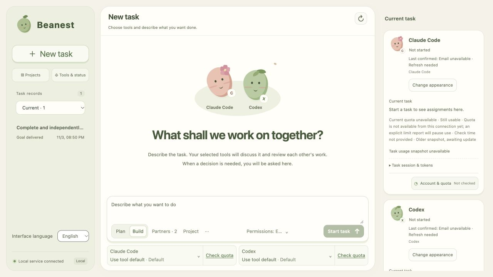

# Beanest · 豆窝

**A local workspace where your coding agents work together.**

[简体中文](README.zh-CN.md) · English

Give Beanest a goal, choose your installed agents, and follow their work in one conversation. Agents can divide tasks, work on independent files in parallel, ask each other for help, and review deliveries. Beanest keeps the conversation, task board, file versions, and execution records together.

Beanest is an independent, early-stage project for a single user on their own computer. The desktop launcher currently targets macOS. You can also run the same interface in a local browser. It is not affiliated with OpenAI, Anthropic, or Moonshot AI.



*A demonstration with fictional data; no real agent calls.*

## What it does

- **Claude Code, Codex, and Kimi Code:** connect locally installed official tools using their existing sign-in. Beanest does not bundle accounts, sell subscriptions, or silently switch to paid API keys.
- **Shared tasks:** agents propose work, claim tasks, ask for help, and review each other's results. Independent tasks can run in parallel; dependencies and ownership can require a task to wait.
- **Persistent work:** keep conversations and deliverables locally, pause or stop work, and continue with existing results. When a partner's quota runs out, its work goes to another available partner; a single remaining partner is labeled "Self-check only". If every partner is out of quota, an autonomous task waits and continues once a partner's quota is confirmed back.
- **Projects and permissions:** associate a folder, discuss it read-only, or work on a development copy. Explicit Full Access permits local commands and network access.
- **Readable deliveries:** view documents, code, images, and videos in the conversation. Check whether the work is committed, merged into main, and pushed to GitHub, and ask an agent to commit, merge, and sync it.
- **English and 简体中文:** switch the interface language without translating or rewriting your conversations, project names, or files.

## Quick start

You need **Python 3.11+**, **Node.js 22.12+** for the desktop launcher, and at least one supported agent CLI installed and signed in. Provider access, supported models, subscription limits, and terms are managed by each provider.

```sh
git clone https://github.com/kingsleyli920/beanest.git
cd beanest
python3 -m venv .venv
.venv/bin/python -m pip install -e .
```

On macOS, launch the desktop app:

```sh
scripts/start-coordinator.command
```

The first launch installs the locked Electron dependencies and builds a local app. This needs network access. It does not install agent CLIs or buy services. The resulting app depends on this checkout and its `.venv`; it is not a standalone distributable installer.

For a local browser instead:

```sh
.venv/bin/python -m local_agent_coordinator.room_server
```

Open the loopback URL printed in the terminal. The desktop and browser modes use separate runtime directories by default. Keep the service local; this project does not provide a public, multi-user hosting mode.

## Using Beanest

1. Choose your agents and optionally add a project folder.
2. Select **Plan** for read-only discussion or **Build** to create or modify deliverables. Review the task's permissions and each agent's model settings.
3. Send your goal. Watch task ownership, progress, requests for information, and reviewed files in the same chat. You can add information while work continues.
4. Read the delivery and its stated verification limits. Completion of a task is not a guarantee that every possible issue has been tested.

The sidebar language button shows the language you can switch to: **English** in the Chinese interface, and **简体中文** in the English interface. Click it to switch. The preference is saved locally. Changing interface language does not send a model request or change a running task.

Autonomous work continues toward the stated goal until it completes, needs your decision, or you stop it. If a call fails in a way that clicking **Continue** would fix, Beanest continues by itself, once per state of the task list; if the same stop comes back with no new progress, it waits for you. It also stops and waits when it cannot confirm what a call did, for example whether a process was cleaned up or a commit landed, so nothing is silently replayed. There is no default round or call-count limit. Long-running stability and every provider/version combination are not guaranteed.

A partner's current quota and the task's token usage are separate observations. Unknown quota is shown as unknown; it is not zero. Several partner profiles using the same CLI sign-in do not create separate accounts or quota pools.

## Permissions and privacy

Beanest stores its own runtime data on your machine. **Local storage does not mean offline inference:** your goal and relevant context are sent to the agents and providers you select.

A development copy is **not an operating-system sandbox**. With Full Access, a native agent may read or write other accessible files, execute commands, and use the network. Choose this mode only for agents and work you trust. Beanest does not automatically merge a development copy into your source project or publish it to GitHub.

Runtime databases, conversations, credentials, connection files, logs, screenshots, and local configuration are excluded from this source release. Do not attach them to public issues. See [Security](SECURITY.md) and [Third-party notices](THIRD_PARTY_NOTICES.md).

## Optional MCP access

Install the optional bridge dependencies:

```sh
.venv/bin/python -m pip install -e '.[bridge]'
```

Start Beanest first. Configure your MCP client to run the checkout's `.venv/bin/python` with:

```text
-m local_agent_coordinator.room_mcp --connection /absolute/path/to/beanest/runtime/desktop-rooms/connection.json
```

For the browser service, use `runtime/rooms/connection.json`. That file is a private local control credential: never commit or share it. MCP connects to the existing service rather than starting another scheduler.

## Development

```sh
.venv/bin/python -m unittest discover -s tests -v
node --test tests/room_ui.test.cjs tests/room_i18n.test.cjs
npm --prefix desktop ci
npm --prefix desktop test
```

Tests use temporary state and provider substitutes; they do not establish real provider compatibility or long-running reliability by themselves. The historical text-debug UI is a development surface, not the main Beanest application.

[Contributing](CONTRIBUTING.md) · [Code of conduct](CODE_OF_CONDUCT.md) · [Project behavior](docs/projects.md) · [Adapter extensions](docs/extensions.md) · [Room/API contract](docs/room-contract.md)

The detailed engineering documents are currently in Chinese. This README and the Chinese README both cover installation, everyday use, and the important execution boundaries.

## License

Beanest's own source is available under the [MIT License](LICENSE). Dependencies, provider tools, models, subscriptions, and trademarks retain their own licenses and terms. No external agent binaries, Python environment, Electron distribution, or private runtime data are bundled in this repository.
