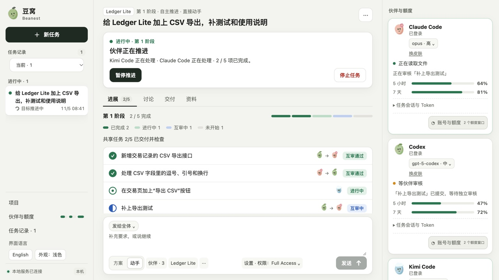

# 豆窝 · Beanest

**让本机的 AI 编程伙伴在同一个工作台里一起做事。**

简体中文 · [English](README.md)

给豆窝一个目标，选择本机已经安装的 Agent，在同一条聊天里看它们分工、并行处理独立文件、互相求助和审核交付。聊天、任务清单、文件版本和执行记录保存在一起，方便随时查看。

这是一个独立的早期项目，面向用户自己的电脑和单用户场景。桌面启动器目前面向 macOS，也可以在本机浏览器使用相同界面。项目与 OpenAI、Anthropic、Moonshot AI 没有官方隶属或背书关系。



*使用虚构数据的界面示例，没有调用真实模型。*

## 能做什么

- **接入 Claude Code、Codex 和 Kimi Code**：使用你安装并登录的官方工具，不捆绑账号、不代售会员、不静默改用付费 API key。
- **共享任务与互审**：伙伴提出方案、认领任务、互相求助并审核成果。伙伴按任务之间真实的依赖并行，你列要求时的先后顺序不算依赖。做到一半你也可以说哪些任务不用等，伙伴会把还没开始的任务调开，交给空着的伙伴，正在做的不受影响。
- **保留工作进度**：聊天和成果保存在本机，可以暂停、停止，也可以在已有结果上继续。某个伙伴额度用完，它手上的活会交给其他可用的伙伴；只剩一位时会标明是自检。所有伙伴额度都用完时，自主任务会等到确认有伙伴额度恢复，再自动继续。
- **角色与工作量**：给每个伙伴定角色（开发、审查、规划或自定义）和这次的工作量，角色显示在卡片和对话里。某个账号额度只剩 15% 左右时，豆窝先把活派给别人。
- **项目与权限**：关联本机文件夹，先只读讨论，或在开发副本中修改。显式选择 Full Access 后，原生 Agent 可以执行本机命令和联网。
- **直接查看交付**：在聊天里阅读文档、代码、图片和视频；查看成果有没有提交、合入 main、推到 GitHub，也可以让伙伴去提交、合入和同步。
- **中英文界面**：切换 English 或简体中文，聊天原文、项目名称和文件内容保持原样。

## 安装

系统要 macOS 13 或更新，还要有 Claude、ChatGPT、Kimi 中至少一家的会员。打开“终端”（在“应用程序 → 实用工具”里），粘贴这一行，按回车：

```bash
curl -fsSL https://raw.githubusercontent.com/kingsleyli920/beanest/main/scripts/install-macos.sh | bash
```

它会按你这台 Mac 的芯片下载对应的包，核对校验和与签名，装进“应用程序”并打开，不会弹出“无法验证”的提示。以后再运行同一行就是升级，对话和设置都会保留。

也可以到 [Releases](https://github.com/kingsleyli920/beanest/releases) 手动下载 zip。这个版本没有经过 Apple 公证，手动下载的版本第一次打开时，要到“系统设置 → 隐私与安全性”里点“仍要打开”。

App 自带运行要用的 Python，不用另装 Python 或 Node.js。还没装 Claude Code、Codex 或 Kimi Code 也没关系：首页可以一键运行各家的官方安装脚本，再用你自己的账号登录。

## 从源码运行

需要 **Python 3.12+**；桌面启动还需要 **Node.js 22.12+**。至少安装并登录一个已支持的官方 Agent CLI。模型权限、会员额度及使用条款由各供应商管理。macOS 自带的 `python3` 是 3.9，用不了；请先装新版本，例如 `brew install python`，再用它创建 `.venv`。

```sh
git clone https://github.com/kingsleyli920/beanest.git
cd beanest
python3 --version   # 需要 3.12 或更新
python3 -m venv .venv
.venv/bin/python -m pip install -e .
```

在 macOS 启动桌面版：

```sh
scripts/start-coordinator.command
```

首次启动会安装锁定的 Electron 依赖并构建本机应用，需要联网；不会安装 Agent CLI 或购买服务。构建出的应用依赖当前源码目录和 `.venv`，不是可以单独搬走的独立安装包。

只使用本机浏览器时：

```sh
.venv/bin/python -m local_agent_coordinator.room_server
```

打开终端打印的 loopback 地址。8769 端口被占用时，加 `--port` 换一个空闲端口。桌面版与独立 Web 版默认使用不同的运行目录。本项目不提供公网、多用户托管模式，请保持服务只在本机使用。

### 构建独立的 macOS App

上面的 App 依赖这份源码和它的 Python 环境。要做一个发给没装 Python、Node.js 的人也能用的版本：

```bash
npm --prefix desktop ci
npm --prefix desktop run build:release                 # 本机芯片
npm --prefix desktop run build:release -- --arch x64   # Intel 版
```


构建时需要 [uv](https://docs.astral.sh/uv/) 和网络，可以在 Apple 芯片的 Mac 上同时构建 Apple 芯片版和 Intel 版，App 要求 macOS 13 或更新。App 和 zip 按芯片生成在 `runtime/desktop-release/arm64/` 或 `runtime/desktop-release/x64/`。App 自带 Python 和后端，用户数据放在 `~/Library/Application Support/io.github.kingsleyli920.beanest`。Agent CLI 仍需用户自己安装并登录。这个构建只做了临时签名，没有公证，从浏览器下载的 zip 第一次打开时 macOS 会要求到系统设置里允许。

## 怎么使用

1. 选择伙伴，需要处理已有项目时添加项目文件夹。
2. 选择“方案”先只读讨论，或选择“动手”实际制作成果；核对任务权限和各伙伴的模型设置。
3. 发送目标，在同一条聊天查看负责人、进展、需要补充的问题和交付文件。工作过程中也可以补充信息。
4. 阅读成果及其验证范围。任务完成不代表所有可能的问题都已经测过。

侧边栏语言按钮显示可切换到的语言：中文界面显示 **English**，英文界面显示 **简体中文**，点击即可切换。偏好保存在本机。切换界面语言不调用模型，也不改变正在执行的任务。

自主任务会一直朝目标推进，直到做完、需要你拍板，或者你喊停。如果某次调用出错，而点“继续”就能解决，豆窝会自己继续，同一个任务清单状态只自动继续一次；同样的停下又出现且没有新进展，就停下等你。确认不了某次调用的结果时（比如进程有没有清理干净、提交有没有成功），它也会停下等你，不会悄悄重来一遍。默认没有轮数和调用次数上限。目前不保证兼容所有供应商和版本，也不保证长时间运行不出错。

点伙伴的模型按钮，还可以给它选一个角色和这次任务的工作量。角色决定它参加哪些环节：“开发”只领实现任务，“审查”只审别人的改动，“规划”写计划、做阶段检查，不选就是“全能”，和以前一样。也可以自己新建角色，写一句职责，勾选参加的环节；自定义角色保存在这台电脑上。不参加规划的伙伴不会被叫去讨论计划，能少花一些额度。某个环节没有合适的人时，其他伙伴会顶上，不会因为角色配得不全卡住。房间里会显示这一轮各环节分别花了多少。

某个账号的额度只剩 15% 左右时，豆窝先把活派给其他伙伴，它也不参加计划讨论；审查时别的伙伴在忙就等一等，只有没人能接时才用它，给你自己留一点。伙伴卡片上会提示额度只剩多少。

账号额度与当前任务 Token 用量分别展示。额度查不到就显示未知，不冒充为零。多个伙伴配置共用同一 CLI 登录时，不代表多个账号，也不会增加额度池。

## 权限与隐私

豆窝自己的运行数据保存在本机。**本机保存不等于离线推理**：目标与所需上下文会发给你选中的 Agent 和供应商。

开发副本**不是操作系统沙箱**。Full Access 下，原生 Agent 可能读写其他可访问的文件、执行命令和联网，只应对可信工具和任务开启。Full Access 用的就是各工具自己的最高权限，豆窝不另加限制；伙伴会像你直接使用它们时一样，把负责的改动写进你的项目。其他权限下，豆窝不会把开发副本合回源项目。豆窝从不自动发布到 GitHub。

运行数据库、聊天、凭据、连接文件、日志、截图和本机配置不随开源代码发布，也请勿直接上传到公开 issue。详见[安全说明](SECURITY.md)和[第三方说明](THIRD_PARTY_NOTICES.md)。

## 可选：MCP 接入

先安装可选桥接依赖：

```sh
.venv/bin/python -m pip install -e '.[bridge]'
```

启动豆窝后，将 MCP 客户端的命令设为源码目录里的 `.venv/bin/python`，参数为：

```text
-m local_agent_coordinator.room_mcp --connection /absolute/path/to/beanest/runtime/desktop-rooms/connection.json
```

独立 Web 服务使用 `runtime/rooms/connection.json`。这个文件是本机私有控制凭据，不要提交或分享。MCP 连接已有服务，不会另起一套调度器。

## 参与开发

```sh
.venv/bin/python -m unittest discover -s tests -v
node --test tests/room_ui.test.cjs tests/room_i18n.test.cjs
npm --prefix desktop ci
npm --prefix desktop test
```

这些测试使用临时数据和供应商替身，不能单独证明真实接入兼容性或长时间稳定性。历史文字调试界面属于开发入口，不是豆窝的主应用界面。

[贡献说明](CONTRIBUTING.md) · [行为准则](CODE_OF_CONDUCT.md) · [项目协作](docs/projects.md) · [适配器扩展](docs/extensions.md) · [房间/API 契约](docs/room-contract.md)

详细工程文档目前主要为中文。中英文 README 均包含安装、日常使用和关键执行边界。

## 许可证

豆窝自有源码采用 [MIT 许可证](LICENSE)。第三方依赖、供应商工具、模型、会员和商标分别遵循各自许可及条款。仓库不捆绑外部 Agent 二进制、Python 环境、Electron 发行包或私有运行数据。
